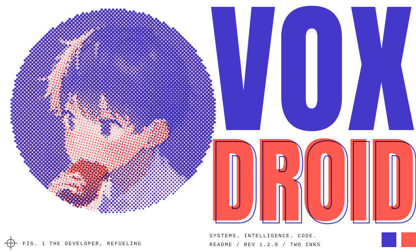
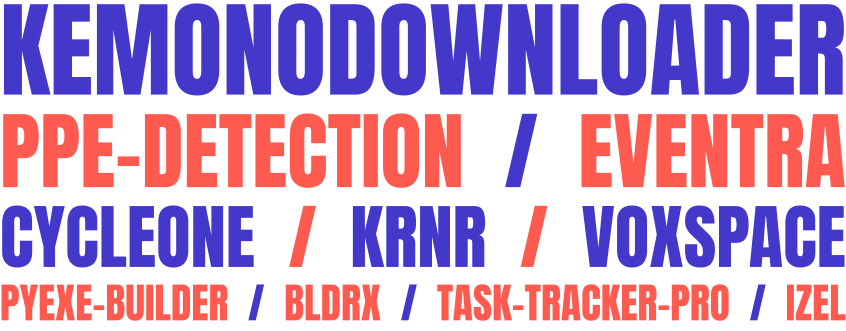

<picture>
  <source media="(prefers-color-scheme: dark)" srcset="readme/poster/hero.dark.svg">
  
</picture>

[Portfolio](https://voxdroid.vercel.app) · [GitHub](https://github.com/VoxDroid) · [Kaggle](https://www.kaggle.com/VoxDroid) · [Hugging Face](https://huggingface.co/iZELX1)

<picture>
  <source media="(prefers-color-scheme: dark)" srcset="readme/poster/h-about.dark.svg">
  
</picture>

Writing code for 6+ years in Python, JavaScript, TypeScript, Rust and C++. I build command-line tools, web and desktop apps and machine-learning projects, and I run a self-hosted homelab.

<picture>
  <source media="(prefers-color-scheme: dark)" srcset="readme/poster/h-focus.dark.svg">
  
</picture>

- **AI and machine learning.** LLMs, computer vision, neural networks and agents.
- **Web development.** Modern, high-performance, responsive applications.
- **Open source.** Contributing, maintaining, and scaling core modules.
- **Cybersecurity.** Ethical hacking, privacy, and network defense.
- **Linux and homelab.** Self-hosted infrastructure and system-level automation.
- **Cloud and DevOps.** Containers, Kubernetes, CI/CD pipelines, and scalable architecture.

<picture>
  <source media="(prefers-color-scheme: dark)" srcset="readme/poster/h-stack.dark.svg">
  
</picture>

<table>
  <tr><th align="left">Languages</th><td>Python · TypeScript · JavaScript · PHP · Rust · C++</td></tr>
  <tr><th align="left">Machine learning</th><td>PyTorch · TensorFlow · scikit-learn · Jupyter</td></tr>
  <tr><th align="left">Web</th><td>React · Next.js · FastAPI</td></tr>
  <tr><th align="left">Infrastructure</th><td>Docker · Kubernetes · Linux · Proxmox · nginx · WireGuard</td></tr>
</table>

<picture>
  <source media="(prefers-color-scheme: dark)" srcset="readme/poster/h-work.dark.svg">
  
</picture>

<picture>
  <source media="(prefers-color-scheme: dark)" srcset="readme/poster/lineup.dark.svg">
  
</picture>

[KemonoDownloader](https://github.com/VoxDroid/KemonoDownloader) · [Construction-Site-Safety-PPE-Detection](https://github.com/VoxDroid/Construction-Site-Safety-PPE-Detection) · [Eventra](https://github.com/VoxDroid/Eventra) · [CycleOne](https://github.com/VoxDroid/CycleOne) · [krnr](https://github.com/VoxDroid/krnr) · [VoxSpace](https://github.com/VoxDroid/VoxSpace) · [PyExe-Builder](https://github.com/VoxDroid/PyExe-Builder) · [bldrx](https://github.com/VoxDroid/bldrx) · [Task-Tracker-Pro](https://github.com/VoxDroid/Task-Tracker-Pro) · [Izel](https://github.com/VoxDroid/izel)

<picture>
  <source media="(prefers-color-scheme: dark)" srcset="readme/poster/h-certified.dark.svg">
  
</picture>

<table>
  <tr><th align="left">Certificate</th><th align="left">Issued by</th><th align="left">Date</th><th align="left">Credential ID</th></tr>
  <tr><td>Cisco Certified Support Technician – Cybersecurity (CCST)</td><td>Cisco</td><td>April 2026</td><td><code>w9war-H9Qu</code></td></tr>
  <tr><td>IBM and ISC2 Cybersecurity Specialist</td><td>IBM / ISC2 via Coursera</td><td>January 2026</td><td><code>M45DYKASB6LV</code></td></tr>
  <tr><td>Google Cybersecurity Professional Certificate</td><td>Google via Coursera</td><td>January 2026</td><td><code>MQ2VW1YU0JSD</code></td></tr>
  <tr><td>Google Data Analytics Professional Certificate</td><td>Google via Coursera</td><td>January 2026</td><td><code>PVDA1J1US6P6</code></td></tr>
  <tr><td>IBM AI Developer Professional Certificate</td><td>IBM via Coursera</td><td>December 2025</td><td><code>WX69NPK042I0</code></td></tr>
</table>

<picture>
  <source media="(prefers-color-scheme: dark)" srcset="readme/poster/h-numbers.dark.svg">
  
</picture>

<picture>
  <source media="(prefers-color-scheme: dark)" srcset="readme/poster/numbers.dark.svg">
  
</picture>

<picture>
  <source media="(prefers-color-scheme: dark)" srcset="readme/poster/h-recent.dark.svg">
  
</picture>

<!--RECENT_ACTIVITY:start-->
<table>
<tr><td>Nov&nbsp;21</td><td>Merged 3 pull requests in <a href="https://github.com/VoxDroid/VoxDroid">VoxDroid</a>, latest <a href="https://github.com/VoxDroid/VoxDroid/pull/9">#9</a> Replace the certifications on the site, CVs and README</td></tr>
<tr><td>Nov&nbsp;20</td><td>Pushed 53 commits to <a href="https://github.com/VoxDroid/KemonoDownloader">KemonoDownloader</a></td></tr>
<tr><td>Nov&nbsp;20</td><td>Pushed 47 commits to <a href="https://github.com/VoxDroid/PawchiveDownloader">PawchiveDownloader</a></td></tr>
<tr><td>Nov&nbsp;20</td><td>Pushed 24 commits to <a href="https://github.com/VoxDroid/PawchiveDownloader-BrowserExtension">PawchiveDownloader-BrowserExtension</a></td></tr>
<tr><td>Nov&nbsp;20</td><td>Merged 3 pull requests in <a href="https://github.com/VoxDroid/PawchiveDownloader-BrowserExtension">PawchiveDownloader-BrowserExtension</a>, latest <a href="https://github.com/VoxDroid/PawchiveDownloader-BrowserExtension/pull/5">#5</a> Decode HTML entities once and strip tags completely</td></tr>
<tr><td>Nov&nbsp;20</td><td>Merged 7 pull requests in <a href="https://github.com/VoxDroid/PawchiveDownloader">PawchiveDownloader</a>, latest <a href="https://github.com/VoxDroid/PawchiveDownloader/pull/10">#10</a> Decode HTML entities once and strip tags completely</td></tr>
<tr><td>Nov&nbsp;20</td><td>Released <a href="https://github.com/VoxDroid/PawchiveDownloader-BrowserExtension/releases/tag/v1.0.0">v1.0.0</a> of <a href="https://github.com/VoxDroid/PawchiveDownloader-BrowserExtension">PawchiveDownloader-BrowserExtension</a></td></tr>
</table>
Last 14 days: 124 commits, 27 pull requests merged, 14 issues closed, 4 releases. Updated Nov 23, 2026, 7:55 PM GMT+9.
<!--RECENT_ACTIVITY:end-->

